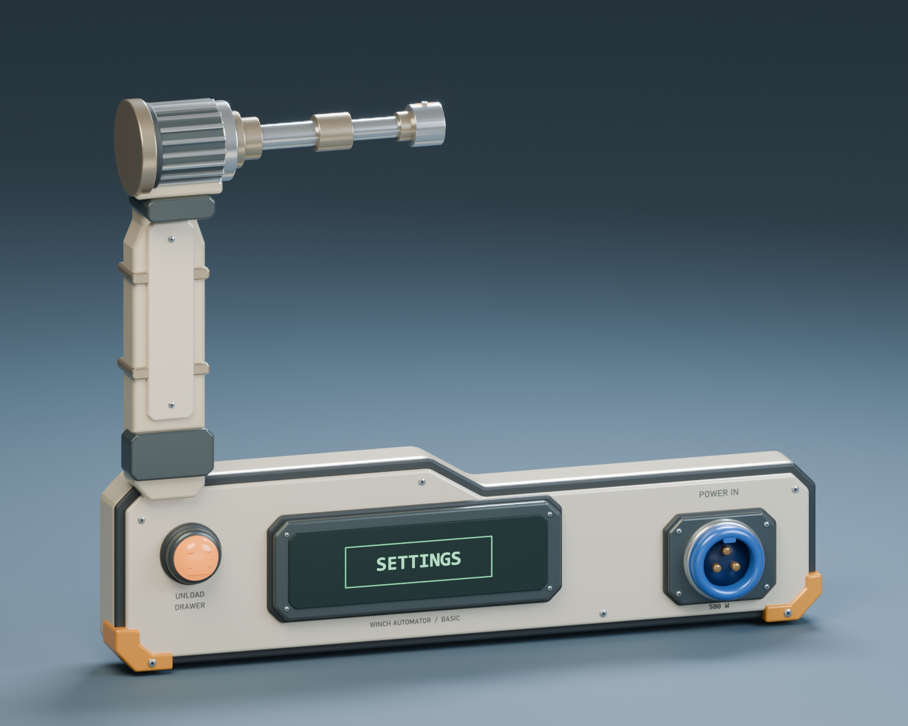
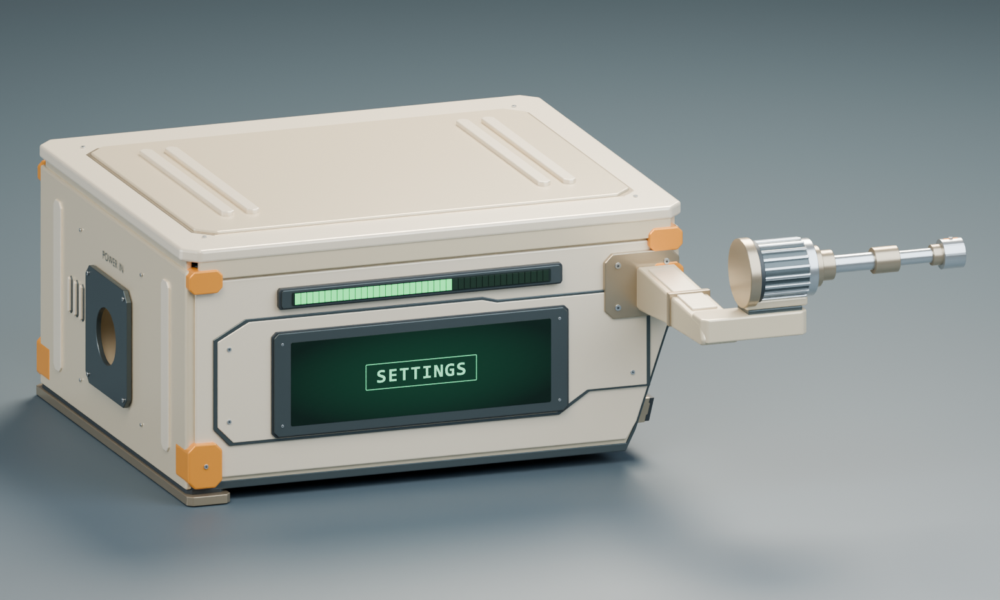
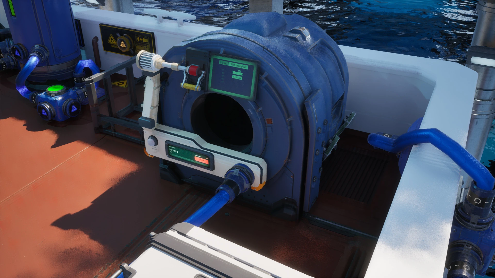
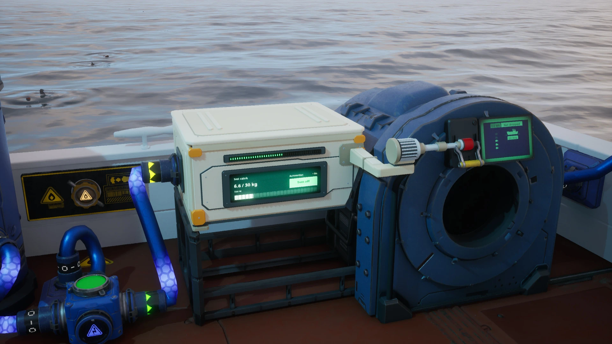

# Ship Net Automation

**[ View on Nexus Mods](https://www.nexusmods.com/thelastcaretaker/mods/454)**

Ship Net Automation adds two buildable winch controllers to *The Last Caretaker*. Both attach to the stock fishing winch and use the ship's electrical network.

## Winch controllers

| Winch Automator Basic | Winch Automator Advanced |
| :---: | :---: |
|  |  |
| **Engineering level 6 · 1 point** Raises the net and flashes an amber lamp. Empty the stock drawer to resume fishing. | **Engineering level 10 · 2 points** Moves catch into a 50 kg cabinet, then lowers the net when the drawer is empty. |
|  |  |

Build the researched controller on the winch, connect **POWER IN**, then interact with the onboard display to switch automation on or off. The display shows catch weight, net capacity and electrical draw.

## Installation

Install with Vortex from [Nexus Mods](https://www.nexusmods.com/thelastcaretaker/mods/454?tab=files) or download the ZIP from [GitHub Releases](https://github.com/umanamente/tlc-ship-net-automation-mod/releases). See the [installation instructions](docs/gamers/installation.md) for the UE4SS requirement and manual steps. The [player guide](docs/gamers/guide.md) covers research and operation, and the [troubleshooting guide](docs/gamers/troubleshooting.md) covers common issues. Each release lists the game version and Steam BuildID used to build and test it. The same compatibility record is included in the ZIP and the [changelog](CHANGELOG.md).

For contributions, see [local development setup](docs/maintainers/development.md), the [asset pipeline](docs/maintainers/asset-pipeline.md) and [architecture decisions](docs/maintainers/adr/README.md). AI agents start with [AGENTS.md](AGENTS.md).
