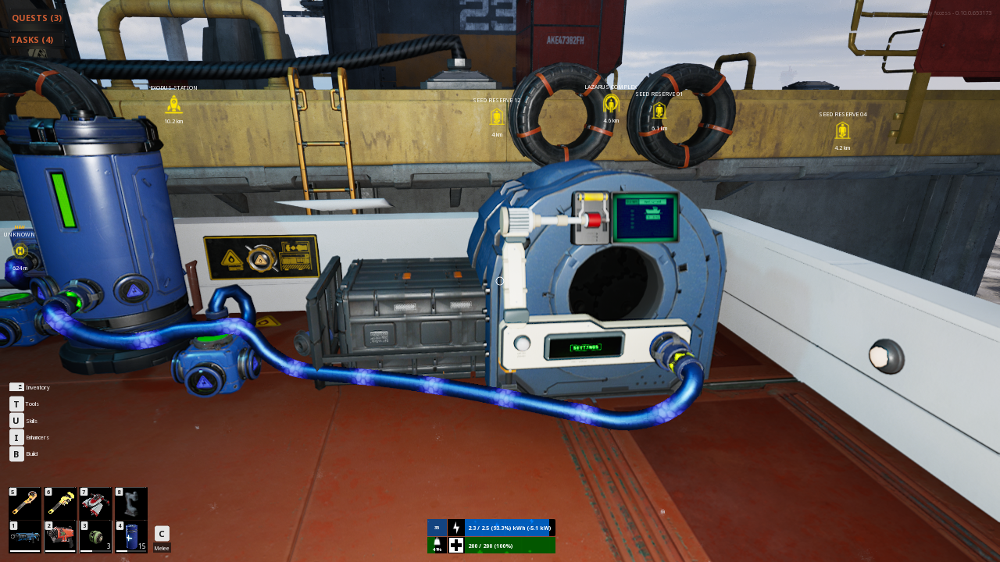

# Using the winch automators

## Research and build

Research **Winch Automator Basic** at level 6 for 1 skill point or **Winch Automator Advanced** at level 10 for 2 points. Open the ordinary Build menu and aim the preview at the stock fishing winch. Basic mounts at the front and Advanced fits over the drawer. A green preview indicates a valid mount. Connect a live cable to **POWER IN** after fabrication.

| Materials | Basic | Advanced |
| --- | --- | --- |
| Alloy Frames | 2 | 4 |
| Conduit Wiring | 2 | 3 |
| Magnetic Coils | 1 | 2 |
| Logic Chips | 1 | 2 |
| Display Screen | 1 | 1 |
| Connector Ports | 1 | 1 |

## Run a fishing cycle

Aim at the display and press the game's **Interact** action. Use the on-screen switch to turn automation on or off. **Esc** exits the close view. The device saves its switch setting.

Both versions wait for the catch to reach the current capacity minus 1 kg, then wait three game seconds without a weight increase before requesting a haul. Basic draws 500 W while powered and enabled. Its amber lamp flashes when the raised drawer has catch. Empty the stock drawer to let Basic lower the net.

Advanced draws 500 W while waiting and up to 4 kW during a cycle. It moves the catch from the raised drawer into its 50 kg cabinet. Open the cabinet by aiming at its casing. The LED gauge pulses red when the cabinet is almost full or none of the remaining catch will fit. Make room to resume a stalled transfer.

You can haul at any weight using the stock lever. Advanced transfers what fits while it has power. If automation is off, the drawer stays raised after the manual haul.
